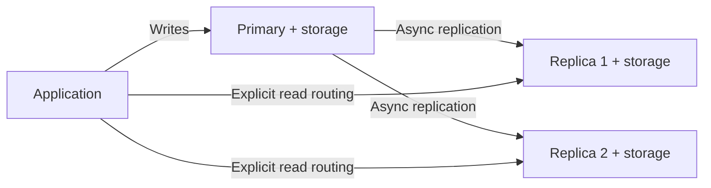
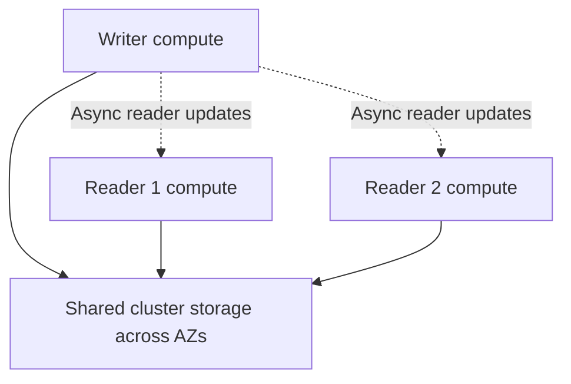
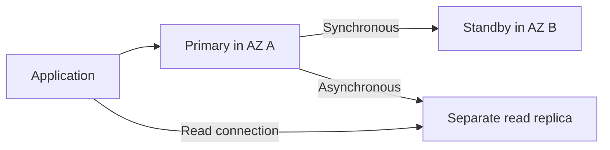
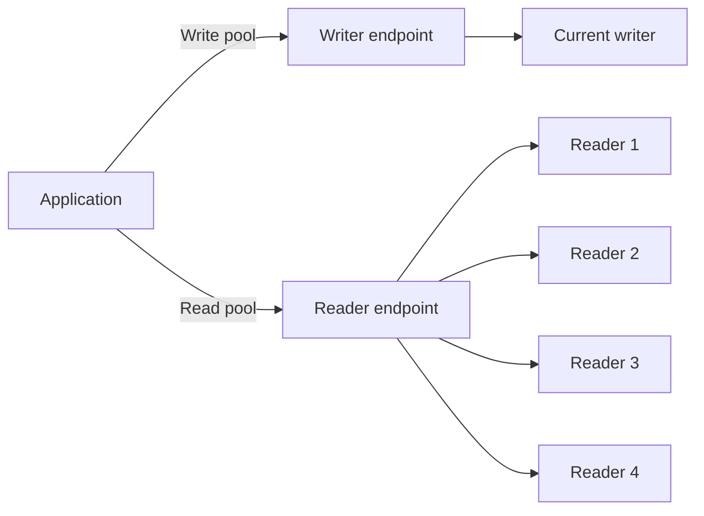

# RDS PostgreSQL vs Aurora PostgreSQL: readers, Multi-AZ, and endpoints

Written: 2026-11-26. Examples use the Daymark Rails lab in `us-east-1`.

This guide compares ordinary RDS PostgreSQL DB instances and their read replicas with a standard Aurora PostgreSQL cluster. RDS Multi-AZ DB clusters are covered separately because they behave differently from RDS Multi-AZ DB instances. Aurora Global Database and Limitless Database are outside this comparison.

## 1. The essential differences

| Question | RDS PostgreSQL | Aurora PostgreSQL |
|---|---|---|
| How do ordinary readers receive updates? | Asynchronous PostgreSQL replication to a separate database instance and storage | Asynchronous reader updates; instances share the cluster storage volume |
| Can a reader return older data? | Yes | Yes, despite shared storage |
| Is a reader automatically a failover target? | An ordinary read replica is not the primary's automatic Multi-AZ standby | An in-cluster Aurora reader can be promoted automatically |
| How do I access four readers? | Four instance endpoints; arrange distribution yourself | One cluster reader endpoint can distribute new connections to all four |
| Does AWS automatically split my SQL into reads and writes? | No | No |

Sources: [RDS read replicas](https://docs.aws.amazon.com/AmazonRDS/latest/UserGuide/USER_ReadRepl.html), [Aurora PostgreSQL replication](https://docs.aws.amazon.com/AmazonRDS/latest/AuroraUserGuide/AuroraPostgreSQL.Replication.html), and [Aurora reader endpoints](https://docs.aws.amazon.com/AmazonRDS/latest/AuroraUserGuide/Aurora.Endpoints.Reader.html).

## 2. RDS read replica vs Aurora reader

### Ordinary RDS PostgreSQL read replica

The primary has its own storage. Each replica maintains another database copy using PostgreSQL's native replication. Updates arrive asynchronously, so the primary can acknowledge a commit before a replica has applied it.



A replica is useful for reporting and read scaling. Promoting an ordinary replica creates an independent writable database and ends its replication relationship; it is a different operation from automatic failover to a Multi-AZ standby. The app must arrange to use the promoted database.

Sources: [RDS PostgreSQL read replicas](https://docs.aws.amazon.com/AmazonRDS/latest/UserGuide/USER_PostgreSQL.Replication.ReadReplicas.html) and [RDS read replica operations](https://docs.aws.amazon.com/AmazonRDS/latest/UserGuide/USER_ReadRepl.html).

### Aurora PostgreSQL reader

An Aurora writer and its readers have separate compute and memory, but use the same logical cluster storage volume. Adding a reader does not create another full independent storage volume. Readers still need to update their in-memory database state, which happens asynchronously.



Source: [Aurora PostgreSQL replication](https://docs.aws.amazon.com/AmazonRDS/latest/AuroraUserGuide/AuroraPostgreSQL.Replication.html).

### Why Aurora is both synchronous and asynchronous

There are two layers:

1. **Storage durability:** commits use synchronous replication to a storage quorum across AZs. A commit does not need every storage copy to acknowledge it.
2. **Reader freshness:** reader state advances asynchronously. The writer does not wait for every reader to become current.

A successful write can therefore be safely committed while an immediate query on a reader still returns the previous value. Shared storage protects committed data; it does not guarantee immediate read-after-write visibility on every reader.

Sources: [Aurora high availability](https://docs.aws.amazon.com/AmazonRDS/latest/AuroraUserGuide/Concepts.AuroraHighAvailability.html) and [AWS explanation of synchronous storage and asynchronous readers](https://repost.aws/knowledge-center/aurora-read-replica-restart).

## 3. RDS Multi-AZ vs Aurora Multi-AZ

### RDS Multi-AZ DB instance: primary and unreadable standby

This was the architecture described for the earlier Daymark RDS deployment:



The standby provides automatic failover and cannot serve application queries. A separate read replica provides read capacity. Having a standby does not automatically move any `SELECT` traffic away from the primary.

Source: [RDS Multi-AZ DB instance deployments](https://docs.aws.amazon.com/AmazonRDS/latest/UserGuide/Concepts.MultiAZSingleStandby.html).

### Aurora: shared storage plus readable failover candidates

Aurora separates two kinds of availability:

- **Storage availability:** data copies span three AZs even if the cluster has only one compute instance.
- **Compute availability:** placing a reader in another AZ provides a running instance that can take over as writer.

Aurora readers can serve reads during normal operation and become the writer after failover. A single-writer cluster still has resilient storage, but lacks an existing reader to promote. Multi-AZ storage alone does not provide the same compute recovery path as a writer plus a reader in another AZ.

Source: [Aurora high availability](https://docs.aws.amazon.com/AmazonRDS/latest/AuroraUserGuide/Concepts.AuroraHighAvailability.html).

### The other RDS option: Multi-AZ DB cluster

RDS also offers a **Multi-AZ DB cluster** for PostgreSQL: one writer and two readable instances across three AZs, using semisynchronous replication. It has writer and reader endpoints. It is a separate deployment type from both the traditional RDS primary/standby pair and Aurora.

Source: [RDS Multi-AZ DB clusters](https://docs.aws.amazon.com/AmazonRDS/latest/UserGuide/multi-az-db-clusters-concepts.html).

| Deployment | Normal compute layout | Readable secondary? | Automatic failover? |
|---|---|---|---|
| RDS Multi-AZ DB instance | Primary + standby in two AZs | Standby: no | Yes, to standby |
| Ordinary RDS read replica | Primary + separately created replica | Yes | No automatic primary failover to that ordinary replica |
| RDS Multi-AZ DB cluster | Writer + two readers in three AZs | Yes | Yes |
| Aurora cluster with cross-AZ reader | Writer + one or more readers | Yes | Yes, eligible reader can become writer |

An RDS read replica can itself have Multi-AZ protection. That protects the replica with its own standby; it does not turn the replica into the original primary's automatic standby. [RDS PostgreSQL replica configuration](https://docs.aws.amazon.com/AmazonRDS/latest/UserGuide/USER_PostgreSQL.Replication.ReadReplicas.Configuration.html)

## 4. Four Aurora readers: which endpoint does the app use?

**Each instance has its own unique endpoint. The cluster also supplies one shared reader endpoint.** They do not all have the same individual hostname.

| Endpoint | Purpose |
|---|---|
| Cluster/writer endpoint | Connect to the current writer; accepts reads and writes |
| Cluster reader endpoint | Distribute new read connections among available readers |
| Instance endpoint | Connect directly to one particular instance |

Sources: [Aurora instance endpoints](https://docs.aws.amazon.com/AmazonRDS/latest/AuroraUserGuide/Aurora.Endpoints.Instance.html) and [Aurora cluster endpoint](https://docs.aws.amazon.com/AmazonRDS/latest/AuroraUserGuide/Aurora.Endpoints.Cluster.html).



You configure the reader endpoint once. Adding readers normally needs no extra per-reader application configuration.

However, the reader endpoint distributes **connections**, not individual SQL queries. A persistent connection keeps using its selected reader. Rails pools reuse connections, so four readers will not necessarily receive equal traffic, especially with few connections or uneven query costs. Keep normal connection pooling; opening a connection for every query adds unnecessary overhead.

If the cluster has no readers, its reader endpoint connects to the writer. Do not treat the reader hostname as a substitute for read-only database permissions.

Source: [Aurora reader endpoint behavior](https://docs.aws.amazon.com/AmazonRDS/latest/AuroraUserGuide/Aurora.Endpoints.Reader.html).

### Does Aurora remove the need to configure reads in the app?

**No. It removes the need to manage the list of reader hosts.** Your application still chooses which connection pool runs a query.

- Send writes, migrations, and reads requiring the freshest state to the writer pool.
- Send reads that tolerate lag to the reader pool.
- If every query uses the writer endpoint, adding readers alone will not offload those queries.

The writer endpoint supports queries as well as updates; it does not inspect a `SELECT` and forward it to a reader. [Writer endpoint behavior](https://docs.aws.amazon.com/AmazonRDS/latest/AuroraUserGuide/Aurora.Endpoints.Cluster.html)

## 5. Four ordinary RDS read replicas

For separately created RDS PostgreSQL read replicas, each has an endpoint. There is no built-in Aurora-style shared reader endpoint for that collection.

The application or a suitable database-aware routing layer must choose among the four. Options include separate pools with application selection, assigning different application processes to different replicas, or operating a proxy that supports the required topology. An ordinary web load balancer does not understand PostgreSQL read/write routing.

Daymark currently accepts only one `PGREPLICAHOST`. Setting it to one RDS replica uses that replica; creating three more does not make Rails discover them. Using all four would require additional routing configuration or a suitable intermediary. With Aurora, the same one reader-host setting can point to the cluster reader endpoint.

The RDS Multi-AZ DB cluster described above is an exception: its built-in readers have a cluster reader endpoint. [RDS Multi-AZ cluster connections](https://docs.aws.amazon.com/AmazonRDS/latest/UserGuide/multi-az-db-clusters-concepts.html)

## 6. Applying this to Daymark

The existing app already has production writer/reader pools and request routing. See [database.yml](../ec2/ec2-with-asg/config/database.yml), [ApplicationRecord](../ec2/ec2-with-asg/app/models/application_record.rb), and [production configuration](../ec2/ec2-with-asg/config/environments/production.rb).

For Aurora, the intended host settings are:

```dotenv
PGHOST=mydb.cluster-cmv8swiq63ji.us-east-1.rds.amazonaws.com
PGREPLICAHOST=mydb.cluster-ro-cmv8swiq63ji.us-east-1.rds.amazonaws.com
PG_AUTH_MODE=iam
AWS_REGION=us-east-1
PGUSER=daymark_iam
PGDATABASE=todo
```

These are configuration examples, not changes applied by this guide. Creating an Aurora cluster does not migrate the old database or create `todo`, `daymark_iam`, grants, and application tables automatically. Verify or migrate them before switching the app.

The existing Rails configuration:

- Routes write requests to the primary.
- Routes GET/HEAD requests to the reader, except for the same browser session's five-second primary-read window after writes.
- Uses the writer by default for runners and background jobs unless explicitly switched.
- Caches dashboard counts per Puma process for ten seconds.

Keep the five-second window with Aurora. It reduces stale-read surprises but does not measure lag or guarantee the replica is current after five seconds. Cached counts can also lag independently of replication.

### IAM policy changes matter

Aurora IAM connection policies use the **cluster resource ID**, not the old RDS instance resource IDs:

```text
arn:aws:rds-db:us-east-1:ACCOUNT_ID:dbuser:CLUSTER_RESOURCE_ID/daymark_iam
```

Replace both placeholders. The cluster resource ID begins with `cluster-` and differs from the friendly name `mydb`. The app's signer must use the actual hostname for each pool. Enable IAM authentication on Aurora and grant `rds_iam` and the required SQL privileges to the application user.

Source: [Aurora IAM connection policy](https://docs.aws.amazon.com/AmazonRDS/latest/AuroraUserGuide/UsingWithRDS.IAMDBAuth.IAMPolicy.html).

### Failover still requires working reconnection

Use the cluster writer endpoint so its hostname continues to identify the current writer after promotion. Existing connections can break; clients need to reconnect and resolve the endpoint again. In-flight transactions can fail. Retry writes only with transaction semantics and duplicate prevention appropriate to the operation.

A specific instance endpoint stays tied to that instance, even when its role changes. [Cluster endpoint](https://docs.aws.amazon.com/AmazonRDS/latest/AuroraUserGuide/Aurora.Endpoints.Cluster.html), [instance endpoint](https://docs.aws.amazon.com/AmazonRDS/latest/AuroraUserGuide/Aurora.Endpoints.Instance.html).

## 7. Observed lab configuration

The earlier read-only AWS inspection on 2026-11-26 returned:

| Instance | Role | AZ | Class | Status |
|---|---|---|---|---|
| `mydb-instance-1` | Writer | `us-east-1a` | `db.t3.medium` | Available |
| `mydb-instance-1-reader` | Reader | `us-east-1b` | `db.t3.medium` | Available |

This is one reader, not four. The cluster storage listed AZs `us-east-1a`, `us-east-1b`, and `us-east-1c`. Compute placement spanned two AZs.

The API returned `MultiAZ: false` in that inspection. Interpret that field alongside cluster membership and actual instance AZs; it does not erase the observed cross-AZ placement. These observations are a snapshot, not a guarantee of the current configuration or proof that Rails has switched to Aurora.

## 8. Read-only verification commands

Inspect membership, resource ID, and endpoints:

```bash
aws rds describe-db-clusters \
  --db-cluster-identifier mydb --region us-east-1 \
  --query 'DBClusters[0].{Cluster:DBClusterIdentifier,ResourceID:DbClusterResourceId,Writer:Endpoint,Reader:ReaderEndpoint,Members:DBClusterMembers}' \
  --output json
```

Inspect instance placement:

```bash
aws rds describe-db-instances --region us-east-1 \
  --query 'DBInstances[?DBClusterIdentifier==`mydb`].{Instance:DBInstanceIdentifier,AZ:AvailabilityZone,Status:DBInstanceStatus,Endpoint:Endpoint.Address}' \
  --output table
```

After deploying the intended Aurora configuration, check both Rails roles:

```bash
docker exec daymark ./bin/rails runner '
  [:writing, :reading].each do |role|
    ApplicationRecord.connected_to(role: role) do
      row = ApplicationRecord.connection.select_one(
        "SELECT current_user, pg_is_in_recovery() AS recovery"
      )
      puts "#{role}: #{row.inspect}"
    end
  end
'
```

Expect `daymark_iam` for both, `recovery=false` for writing and `recovery=true` for reading when a reader is available. This checks pool connections; proving HTTP request routing requires observing a real request, as done previously for the RDS replica.

On Aurora PostgreSQL, inspect reader status using:

```sql
SELECT * FROM aurora_replica_status();
```

Use reader lag monitoring alongside workload and query latency. A successful health check alone does not establish replica freshness. [Aurora reader status function](https://docs.aws.amazon.com/AmazonRDS/latest/AuroraUserGuide/aurora_replica_status.html)


Correct. In Aurora, the data layer is already Multi-AZ by default: the cluster volume keeps 6 copies of your data across 3 AZs, regardless of how many instances you run. You don't create or pay for a separate standby instance.

The one caveat is compute. If you run only a single writer instance with no replicas, your data survives an AZ failure, but you'd have downtime while Aurora creates a new instance (several minutes). So for real high availability, add at least one Aurora replica in a different AZ. It serves reads normally and gets promoted automatically if the writer fails (failover in about 30 seconds).

That's the main cost difference from RDS: an RDS Multi-AZ standby is a passive instance you pay for but can't read from, while an Aurora replica doing HA duty also serves read traffic.


	Write	Read
Aurora	Cluster endpoint	Reader endpoint (all replicas)
RDS instance	Instance endpoint	One endpoint per replica
RDS Multi-AZ DB cluster	Cluster endpoint	Reader endpoint


For the exam, "disaster recovery across Regions with very low RPO and RTO" or "global users reading relational data locally" means Global Database. "High availability" with no mention of Regions means a regular cluster with replicas.