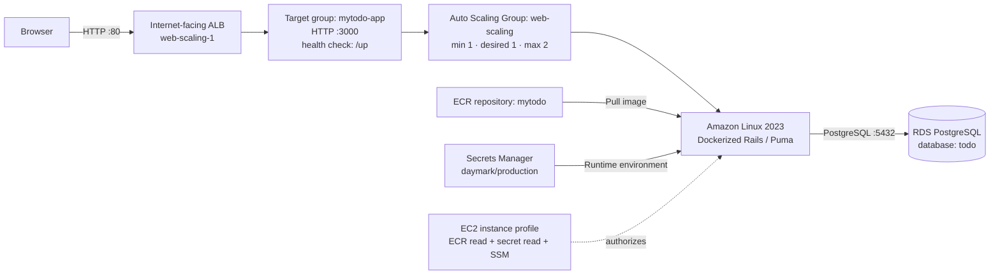

# Daymark

Daymark is a Ruby on Rails todo list with create, read, update, and delete actions. It has no signup or login: anyone who can reach the public app can edit or delete todos. PostgreSQL stores the shared todo data so every EC2 instance in the Auto Scaling Group sees the same records.

## Deployed architecture

The current deployment is in AWS `us-east-1`:



**Public app URL:** [http://web-scaling-1-1968462550.us-east-1.elb.amazonaws.com](http://web-scaling-1-1968462550.us-east-1.elb.amazonaws.com)

The ASG uses a CPU target-tracking policy with a 30% average CPU target and ELB health checks. At the time of this documentation, one instance is healthy and serving traffic.

## What was built and why

1. **Rails todo app.** Rails 7.1 provides the full-stack app and CRUD endpoints. There is no authentication because the requested app is open to all visitors.
2. **PostgreSQL support.** The `pg` gem and PostgreSQL database configuration let the app connect to RDS. A shared database is required because local EC2 storage would not be shared across ASG instances.
3. **Local `.env` support.** `dotenv-rails` loads local PostgreSQL settings in development and test. The checked-in `.env.example` shows the variable names; `.env` itself is ignored by Git.
4. **Production image.** The Docker image packages Rails and its dependencies so each ASG instance runs the same build. It is pushed to ECR as `546208175646.dkr.ecr.us-east-1.amazonaws.com/mytodo:latest`.
5. **Production secret.** Secrets Manager stores the database connection values and `SECRET_KEY_BASE`. The EC2 instance retrieves the secret at startup; credentials are not baked into the image. `FORCE_SSL=false` is set because this ALB currently has an HTTP listener only.
6. **Separate security groups.** The ALB group allows public HTTP. The app group allows Rails port 3000 from the ALB group. The RDS group allows PostgreSQL 5432 from the app group and the configured administrator IP.
7. **EC2 permissions.** The launch template uses `EC2-SSM-ECR-SecretsReadRole`. Its policies allow Systems Manager access, ECR image pulls, and `GetSecretValue` for `daymark/production`.
8. **Launch template v7.** The template starts Docker, logs in to ECR using the EC2 role, downloads the secret into a permission-restricted environment file, pulls the image, and starts Rails. It does not contain AWS access keys.
9. **ALB and target group.** The `mytodo-app` target group forwards HTTP traffic to port 3000 and checks `/up`. The listener sends public HTTP traffic to this target group.
10. **ASG rollout.** `web-scaling` uses launch-template version 7, minimum 1, desired 1, maximum 2. An instance refresh replaced the old instance. The ASG now uses ELB target health to detect an unhealthy app instance.

### Deployment corrections made

The first launch-template startup script had a shell quoting error. The image downloaded, but the container did not start. Cloud-init logs exposed the error, so the user data was corrected in version 7 and the instance was refreshed again.

After the container started, the ALB returned an HTTPS redirect because `FORCE_SSL` was missing from the secret and Rails defaults it to true. The secret was updated to set `FORCE_SSL=false`, the container was restarted, and the ALB homepage was verified to return HTTP 200.

The launch template also initially pinned an instance subnet outside the ASG VPC. Version 7 removes that subnet pin so the ASG selects its configured subnets. The ASG subnets have an Internet Gateway route but no NAT gateway or ECR/Secrets Manager VPC endpoints, so the launch template assigns a public IPv4 address for outbound downloads. The app security group restricts inbound port 3000 to the ALB.

## Production settings

The Secrets Manager secret is named `daymark/production`. It should contain these string keys:

```text
RAILS_ENV
SECRET_KEY_BASE
FORCE_SSL
PGHOST
PGPORT
PGUSER
PGPASSWORD
PGDATABASE
```

The current database is RDS PostgreSQL database `todo`. `PGHOST`, the database username and password are stored in Secrets Manager. Do not put AWS access keys in this secret, in user data, or in the Docker image; EC2 uses its instance profile for AWS access.

`FORCE_SSL` must remain `false` while the ALB has only an HTTP listener. To enable HTTPS, add an ACM certificate and an ALB HTTPS listener, redirect HTTP to HTTPS, then set `FORCE_SSL=true` in the secret.

## Build and push an image

Run these commands from this directory with AWS CLI credentials and Docker Buildx configured. The ECR repository already exists. Use a new version tag for future releases:

```bash
REGION=us-east-1
ACCOUNT_ID=$(aws sts get-caller-identity --query Account --output text)
IMAGE="$ACCOUNT_ID.dkr.ecr.$REGION.amazonaws.com/mytodo:v2"

aws ecr get-login-password --region "$REGION" \
  | docker login --username AWS --password-stdin \
    "$ACCOUNT_ID.dkr.ecr.$REGION.amazonaws.com"
docker buildx build --platform linux/amd64 --tag "$IMAGE" --push .
```

## Deploy a new image version

The startup script currently names an image tag. For a release tagged `v2`:

1. Push `mytodo:v2` to ECR using the commands above.
2. In **EC2 → Launch templates → Mytemp**, create a new version from the active version. In user data, update the image URI from `mytodo:latest` to `mytodo:v2`. Preserve the app security group, `EC2-SSM-ECR-SecretsReadRole` profile, secret lookup, and network interface settings.
3. Set `web-scaling` to use the new launch-template version.
4. Start an instance refresh. Wait for the new target to become healthy before considering the rollout complete.

The Docker entrypoint runs `bin/rails db:prepare` before starting the Rails server. On first boot this prepares the RDS schema; on later boots it checks the existing database.

## Database load improvements

The homepage now displays 50 tasks per page, fetching at most 51 records to
detect the next page without an additional total-count query. The same limit
applies when redisplaying an invalid task submission. Filters are preserved
between pages, and the ID is a final sort key so tied timestamps have a stable
order. Numbered pages use offsets; very deep browsing still has increasing
database cost and may eventually warrant cursor pagination.

Production caches only the dashboard's grouped counts in each Puma process
for 10 seconds (with a 2-second expiry race allowance). Counts can briefly lag
behind writes or differ across instances; task rows are not cached. No Redis
or new secrets are required. Cold processes still run the aggregate query.

Migration `20261124130000` adds a PostgreSQL index matching the list ordering:
`completed ASC, due_date ASC, created_at DESC, id DESC`. It is built concurrently
to allow writes during creation. Existing indexes are preserved.

To deploy these changes, build and push a new image tag, run `bin/rails db:migrate`
once using that image and the existing production environment, then update the
launch template's image and refresh the ASG. Verify that the migration completed
before refreshing instances. The current container entrypoint also runs
`db:prepare`, but running the migration once first avoids multiple booting
instances attempting the index migration together.

After deployment, test small loads first and compare RDS load, query latency,
and homepage p95 with the previous version. These changes bound homepage row
loading; they do not establish the database's maximum write throughput.

## Run locally

PostgreSQL is the default adapter. Copy the sample environment file, set local database values, then prepare and start Rails:

```sh
cp .env.example .env
bundle install
bin/rails db:prepare
bin/rails server
```

Rails loads `.env` in development and test. Local database names default to `daymark_development` and `daymark_test`; configure `PGHOST`, `PGPORT`, `PGUSER`, `PGPASSWORD`, and optionally `PGDATABASE` / `PGTESTDATABASE`.

## Current security considerations

- Anyone on the internet can create, edit, complete, or delete todos because the app has no login.
- The ALB currently serves HTTP only; credentials and session traffic are not protected by TLS.
- The EC2 instance has a public IPv4 address for outbound access to ECR and Secrets Manager. Its Rails port is intended to accept traffic from the ALB group only. Public IPv4 addresses incur AWS charges.
- The app security group currently allows SSH on port 22 from `0.0.0.0/0`. Restrict this to a trusted IP or remove it if SSH is unnecessary. Systems Manager access is already configured.
- RDS is marked publicly accessible. Its security group restricts PostgreSQL access, but a hardened setup should place RDS in private subnets and remove workstation access when it is no longer needed.
- The old default security group retains legacy rules but is no longer attached to the active ALB, RDS, or app instance. The active launch template uses the dedicated Daymark app group.
