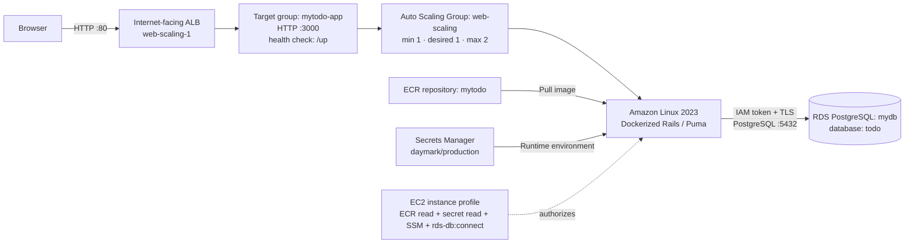

# Daymark

Daymark is a Ruby on Rails todo list with create, read, update, and delete actions. It has no signup or login: anyone who can reach the public app can edit or delete todos. PostgreSQL stores the shared todo data so every EC2 instance in the Auto Scaling Group sees the same records.

## Deployed architecture

The current deployment is in AWS `us-east-1`:



**Public app URL:** [http://web-scaling-1-1968462550.us-east-1.elb.amazonaws.com](http://web-scaling-1-1968462550.us-east-1.elb.amazonaws.com)

The ASG was configured with a CPU target-tracking policy with a 30% average CPU target and ELB health checks. After the IAM migration and SQL permission fixes below, the user confirmed the app could connect. Current instance counts, target health, and launch-template version have not been independently rechecked.

## What was built and why

1. **Rails todo app.** Rails 7.1 provides the full-stack app and CRUD endpoints. There is no authentication because the requested app is open to all visitors.
2. **PostgreSQL support.** The `pg` gem and PostgreSQL database configuration let the app connect to RDS. A shared database is required because local EC2 storage would not be shared across ASG instances.
3. **Local `.env` support.** `dotenv-rails` loads local PostgreSQL settings in development and test. The checked-in `.env.example` shows the variable names; `.env` itself is ignored by Git.
4. **Production image.** The Docker image packages Rails and its dependencies so each ASG instance runs the same build. It is pushed to ECR as `546208175646.dkr.ecr.us-east-1.amazonaws.com/mytodo:latest`.
5. **Production secret.** Secrets Manager stores database connection settings and `SECRET_KEY_BASE`. The EC2 instance retrieves the secret at startup. With IAM enabled, Rails generates database tokens using the EC2 role instead of reading a database password. `FORCE_SSL=false` is set because this ALB has an HTTP listener only; database TLS is configured separately.
6. **Separate security groups.** The ALB group allows public HTTP. The app group allows Rails port 3000 from the ALB group. The RDS group allows PostgreSQL 5432 from the app group and the configured administrator IP.
7. **EC2 permissions.** The launch template uses `EC2-SSM-ECR-SecretsReadRole`. Keep Systems Manager, ECR, and secret-read permissions, and add the scoped `rds-db:connect` policy below for IAM database login.
8. **Launch template startup.** Originally documented as version 7, the template starts Docker, logs in to ECR using the EC2 role, downloads the secret into a permission-restricted environment file, pulls the image, and starts Rails. It does not contain AWS access keys.
9. **ALB and target group.** The `mytodo-app` target group forwards HTTP traffic to port 3000 and checks `/up`. The listener sends public HTTP traffic to this target group.
10. **ASG rollout.** The original `web-scaling` configuration used launch-template version 7, minimum 1, desired 1, maximum 2. Instance refreshes replaced instances during the IAM migration. The ASG uses ELB target health to detect an unhealthy app instance.

### Deployment corrections made

The first launch-template startup script had a shell quoting error. The image downloaded, but the container did not start. Cloud-init logs exposed the error, so the user data was corrected in version 7 and the instance was refreshed again.

After the container started, the ALB returned an HTTPS redirect because `FORCE_SSL` was missing from the secret and Rails defaults it to true. The secret was updated to set `FORCE_SSL=false`, the container was restarted, and the ALB homepage was verified to return HTTP 200.

The launch template also initially pinned an instance subnet outside the ASG VPC. Version 7 removes that subnet pin so the ASG selects its configured subnets. The ASG subnets have an Internet Gateway route but no NAT gateway or ECR/Secrets Manager VPC endpoints, so the launch template assigns a public IPv4 address for outbound downloads. The app security group restricts inbound port 3000 to the ALB.

## Production settings

### Connect Rails using the EC2 IAM role

The replacement database used for this setup is:

| Setting | Value |
| --- | --- |
| Region | `us-east-1` |
| RDS instance identifier | `mydb` |
| Endpoint | `mydb.cmv8swiq63ji.us-east-1.rds.amazonaws.com` |
| Database | `todo` |
| IAM database user | `daymark_iam` |
| Administrator | `postgres` (password authentication) |
| Resource ID | `db-IY25SIGH3YDUZEATVB67IXCVKA` |
| Container | `daymark` |
| EC2 role | `EC2-SSM-ECR-SecretsReadRole` |
| Secret | `daymark/production` |

These values came from the setup session. Recreating RDS again requires updating
the endpoint and the policy's Resource ID.

The app now supports `PG_AUTH_MODE=iam`. In this mode, the AWS SDK resolves
credentials from its standard provider chain (the EC2 instance profile in this
deployment) and signs a new RDS login token for every physical connection.
Reconnects open a fresh client instead of resetting a client with an expired
token. TLS verifies both the certificate chain and RDS endpoint name. Password
authentication remains the default for local development.

The following steps reproduce the configuration. Repository edits alone do not
change AWS resources or update an already published image.

1. Create RDS PostgreSQL in the ASG's VPC with **Password and IAM database
   authentication** enabled and initial database name `todo`. Allow port 5432
   from the app security group. Record the endpoint and the **Resource ID** from
   the instance's Configuration tab. A replacement DB has a new Resource ID.
2. Open **EC2 → Instances → app instance → Connect → Session Manager**.
   Run these commands on the EC2 host, outside Docker, to install the client and
   connect as the password-authenticated master user:

   ```bash
   sudo dnf install -y postgresql17
   psql --version

   psql "host=mydb.cmv8swiq63ji.us-east-1.rds.amazonaws.com port=5432 dbname=todo user=postgres sslmode=require" -W
   ```

   Enter the RDS master password at the prompt. This administrator connection
   uses a password to configure the app's IAM user; Rails uses IAM afterward.
   At the `todo=>` prompt, create
   the app user and grant permissions for the current startup `db:prepare`:

   ```sql
   CREATE USER daymark_iam;
   GRANT rds_iam TO daymark_iam;
   GRANT CONNECT, TEMPORARY ON DATABASE todo TO daymark_iam;
   GRANT USAGE, CREATE ON SCHEMA public TO daymark_iam;
   ```

   If `daymark_iam` already exists, skip `CREATE USER`. Verify its IAM membership:

   ```sql
   \du daymark_iam
   SELECT pg_has_role('daymark_iam', 'rds_iam', 'member');
   ```

   Expect `t`. An empty Attributes column in `\du` is normal.

   **Existing tables:** in this setup, Rails tables already existed under another
   owner. Run the following as `postgres`, still connected to `todo`, to grant
   access to app tables, Rails metadata tables, and ID sequences:

   ```sql
   GRANT SELECT, INSERT, UPDATE, DELETE
   ON ALL TABLES IN SCHEMA public TO daymark_iam;

   GRANT USAGE, SELECT
   ON ALL SEQUENCES IN SCHEMA public TO daymark_iam;

   SELECT has_table_privilege(
     'daymark_iam', 'public.schema_migrations', 'SELECT'
   );
   ```

   Expect `t` from the final query when `schema_migrations` exists. These grants
   apply to existing objects; future objects created by another user need their
   own grants or default privileges configured for that creator.

   Rails must create its tables using this user so it owns them and can migrate
   them later. If tables were already created using another user, an administrator
   must arrange appropriate ownership before migrating as `daymark_iam`.
   Granting CRUD alone does not grant permission to alter existing tables. Keep
   the master user on password authentication: PostgreSQL's `rds_iam` membership
   takes precedence over password authentication, including indirect membership.
   This lab uses the same identity for runtime and migrations to match its
   startup script; a deployment with a separate migration process can give the
   runtime identity narrower privileges.
   Exit PostgreSQL with `\q` when finished.
3. Open **IAM → Roles → EC2-SSM-ECR-SecretsReadRole → Add permissions →
   Create inline policy → JSON**. Add this policy and name it
   `DaymarkRDSIAMConnect`. The username must
   exactly match the SQL user:

   ```json
   {
     "Version": "2012-10-17",
     "Statement": [
       {
         "Effect": "Allow",
         "Action": "rds-db:connect",
         "Resource": "arn:aws:rds-db:us-east-1:546208175646:dbuser:db-IY25SIGH3YDUZEATVB67IXCVKA/daymark_iam"
       }
     ]
   }
   ```

   Preserve ECR, SSM, and Secrets Manager permissions. This ARN uses `rds-db`,
   not `rds`, and the Resource ID, not the instance identifier.
4. Update `daymark/production` with these settings, preserving `SECRET_KEY_BASE`
   and the other application settings:

   ```text
   PG_AUTH_MODE=iam
   AWS_REGION=us-east-1
   PGHOST=mydb.cmv8swiq63ji.us-east-1.rds.amazonaws.com
   PGPORT=5432
   PGDATABASE=todo
   PGUSER=daymark_iam
   PGSSLROOTCERT=/rails/config/certs/rds-global-bundle.pem
   ```

   Remove `PGPASSWORD` for this IAM deployment. Do not store an auth token or
   static AWS access keys. The remaining secret contains Rails' own secret and
   connection settings; it is no longer supplying a database password. Ensure
   the startup script passes the new keys through to Docker's environment file
   if it uses a whitelist. Remove `DATABASE_URL` if configured so it cannot
   override the intended host or user.
5. Build and push the IAM-enabled code using the commands below. This deployment
   keeps `mytodo:latest`; the new Dockerfile includes the public RDS CA bundle.
   A tag named `latest` does not prove an image contains the newest local code.
6. Check that the launch template uses that image and the same instance
   profile. Under advanced metadata options use **metadata accessible/enabled**,
   **IMDSv2 required**, and **metadata response hop limit 2**. With Docker bridge
   networking, hop limit 1 can prevent the SDK inside the container from reaching
   IMDSv2. Container routing/firewall settings must also allow metadata access.
   Keep the existing port publishing and secret retrieval settings. Create a
   new launch-template version only if these settings or the image URI need
   changing. Reusing the same `latest` URI does not require an image URI change.
7. Before starting multiple instances, run `./bin/rails db:prepare` once using
   the new image and IAM environment on a role-equipped EC2 host. This creates
   the schema as `daymark_iam` without concurrent ASG migrations. Select the
   appropriate launch-template version in `web-scaling`, then start an instance
   refresh. The startup script must pull the image and read the updated secret.
   The public ALB URL does not change.
8. On the EC2 host, verify the environment and then use a fresh Rails process to
   check the credential source, connected SQL identity, IAM membership, and TLS:

   ```bash
   docker ps --format 'table {{.Names}}\t{{.Image}}'

   docker inspect daymark \
     --format '{{range .Config.Env}}{{println .}}{{end}}' \
     | grep -E '^(PG_AUTH_MODE|AWS_REGION|PGHOST|PGUSER|PGDATABASE)='

   docker exec -e PGPASSWORD= daymark ./bin/rails runner '
     abort "IAM code is missing from this image" unless defined?(RdsIamAuthentication)
     abort "PG_AUTH_MODE is not iam" unless ENV["PG_AUTH_MODE"] == "iam"

     provider = Aws::CredentialProviderChain.new.resolve
     puts "AWS credential provider: #{provider.class.name}"
     connection = ActiveRecord::Base.connection
     puts "Database user: #{connection.select_value("SELECT current_user")}"
     puts "IAM membership: #{connection.select_value("SELECT pg_has_role(current_user, '\''rds_iam'\'', '\''member'\'')")}"
     puts "TLS: #{connection.select_value("SELECT ssl FROM pg_stat_ssl WHERE pid = pg_backend_pid()") }"
   '
   ```

   Expected verification output:

   ```text
   AWS credential provider: Aws::InstanceProfileCredentials
   Database user: daymark_iam
   IAM membership: true
   TLS: true
   ```

   The command clears `PGPASSWORD` only for this new process and prints no
   credentials or tokens. PostgreSQL IAM membership makes IAM authentication
   take precedence over the user's password. Check ALB target health, load the homepage,
   and create/edit a todo. The `/up` endpoint alone does not verify DB access.
   Reconnect verification after 15 minutes is also useful on the actual deployment.

Local connection tests need neither RDS nor AWS access:

```bash
bundle exec ruby test/rds_iam_authentication_test.rb
```

They use the real Rails adapter and token signer, replacing the PostgreSQL
network call and clock to check a reconnect after token expiry. They do not
verify deployed IAM policies, network reachability, or RDS TLS certificates.

AWS references: [IAM database authentication](https://docs.aws.amazon.com/AmazonRDS/latest/UserGuide/UsingWithRDS.IAMDBAuth.html),
[database users](https://docs.aws.amazon.com/AmazonRDS/latest/UserGuide/UsingWithRDS.IAMDBAuth.DBAccounts.html),
[IAM policy](https://docs.aws.amazon.com/AmazonRDS/latest/UserGuide/UsingWithRDS.IAMDBAuth.IAMPolicy.html),
and [EC2 metadata options](https://docs.aws.amazon.com/AWSEC2/latest/UserGuide/configuring-instance-metadata-options.html).

### Picking up Secrets Manager changes

Secrets are retrieved by the EC2 startup script, not continuously by Rails.

| Action | Loads the updated secret? |
| --- | --- |
| Edit the secret in Secrets Manager | No change to existing containers |
| `docker restart daymark` | No; the container retains its configured environment |
| ASG instance refresh | Yes, when startup fetches the secret and creates the container |
| Fetch the secret again and recreate the container with that environment | Yes |

Save all secret edits before starting one instance refresh. A secret-only edit
does not require an image rebuild. SQL grants take effect in the database and
do not require an instance refresh; a restarting app can retry automatically.

### IAM migration troubleshooting

Run these on the EC2 host, including when `docker exec` reports that the
container is restarting:

```bash
docker logs --since 1m --tail 100 daymark
docker inspect daymark --format 'Status={{.State.Status}} ExitCode={{.State.ExitCode}} Error={{.State.Error}}'
```

| Symptom | Cause or next check |
| --- | --- |
| `IAM code is missing from this image` | Rebuild and push the local IAM changes, then replace the container with a pull of that image. The `latest` label alone is insufficient. |
| `fe_sendauth: no password supplied`, with the trace at the password fallback | `PG_AUTH_MODE=iam` was missing in this setup after the password was removed. Verify the container environment. |
| Missing `AWS_REGION` / `KeyError` | Set `AWS_REGION=us-east-1` in the secret and ensure it reaches Docker. |
| No AWS credentials available | Check the attached instance profile, IMDS access from Docker, and metadata response hop limit. |
| IAM/PAM authentication failure | Check RDS IAM authentication is enabled, the exact database username, `rds_iam` membership, and the role's `rds-db:connect` Resource ID and username. |
| `permission denied for table schema_migrations` | Connect as `postgres` to `todo` and apply the existing-table grants above. This error occurred during the migration and was resolved before the user confirmed connectivity. |
| `must be owner of table ...` during a migration | Table grants do not permit changing another owner's table definition. Arrange ownership or use an authorized migration identity. |
| Connection timeout | Check endpoint, subnet routing, and RDS inbound TCP 5432 from the EC2 app security group. |

For table privilege behavior, see [PostgreSQL privileges](https://www.postgresql.org/docs/18/ddl-priv.html).

### Optional same-Region read replica

Production enables separate writer and reader pools when `PGREPLICAHOST` is
nonempty. Without it, the app continues using only the primary. Keep the
existing `PGHOST` pointing to `mydb` and add this key to `daymark/production`:

```text
PGREPLICAHOST=mydbreplica.cmv8swiq63ji.us-east-1.rds.amazonaws.com
```

Verify IAM database authentication is enabled on `mydbreplica` and its security
group permits TCP 5432 from the EC2 app. The `daymark_iam` PostgreSQL role and
its grants replicate from the primary; do not run CREATE USER on the read-only
replica. Retrieve the replica's own Resource ID from your workstation:

```bash
aws rds describe-db-instances \
  --db-instance-identifier mydbreplica --region us-east-1 \
  --query 'DBInstances[0].{Endpoint:Endpoint.Address,ResourceID:DbiResourceId,IAM:IAMDatabaseAuthenticationEnabled,Status:DBInstanceStatus}' \
  --output table
```

In `DaymarkRDSIAMConnect`, change `Resource` to an array containing the existing
primary ARN plus
`arn:aws:rds-db:us-east-1:546208175646:dbuser:REPLICA_RESOURCE_ID/daymark_iam`.
Replace `REPLICA_RESOURCE_ID` with the full `db-...` value from that command.
The IAM signer uses each connection's hostname, so tokens are signed separately
for primary and replica. Both must be in `AWS_REGION` with this implementation.

Rebuild and push the image using the deployment commands above. Ensure the EC2
startup script passes `PGREPLICAHOST` from the secret into the container, then
refresh the ASG instances to load the image and secret. A secret edit or Docker
restart alone does not update the existing container's environment.

Rails routes POST/PUT/PATCH/DELETE requests to the writer and GET/HEAD requests
to the reader, except that reads from the same browser session use the writer
for five seconds after a write. This delay does not measure replication lag;
stale reads are possible. Existing dashboard counts are also cached for ten
seconds. Background jobs and Rails runners use the writer unless they explicitly
switch roles. Migrations run only against the primary. There is no automatic
fallback to the writer if the replica is unavailable; removing `PGREPLICAHOST`
and redeploying disables reader routing.

On an updated EC2 host, verify actual database connections:

```bash
docker exec daymark ./bin/rails runner '
  [:writing, :reading].each do |role|
    ApplicationRecord.connected_to(role: role) do
      connection = ApplicationRecord.connection
      user = connection.select_value("SELECT current_user")
      recovery = connection.select_value("SELECT pg_is_in_recovery()")
      puts "#{role}: user=#{user}, recovery=#{recovery}"
    end
  end
'
```

Expect `daymark_iam` for both roles, with `recovery=false` for writing and
`recovery=true` for reading. Local configuration and signer checks do not
establish deployed RDS connectivity; run this after deployment.

See [Rails multiple database routing](https://guides.rubyonrails.org/v7.1/active_record_multiple_databases.html).

### Previous password-based deployment settings

For reference, the earlier password-based deployment used these keys in
`daymark/production`, with `PG_AUTH_MODE` omitted or set to `password`:

```text
RAILS_ENV
SECRET_KEY_BASE
FORCE_SSL
PGHOST
PGPORT
PGUSER
PGPASSWORD
PGDATABASE
```

The IAM deployment above no longer needs `PGPASSWORD`. Do not put AWS access keys in this secret, in user data, or in the Docker image; EC2 uses its instance profile for AWS access.

`FORCE_SSL` must remain `false` while the ALB has only an HTTP listener. To enable HTTPS, add an ACM certificate and an ALB HTTPS listener, redirect HTTP to HTTPS, then set `FORCE_SSL=true` in the secret.

## Build and push an image

Run these commands on the local machine with the updated source, AWS CLI
credentials, and Docker Buildx configured. The ECR repository already exists.
This reproduces the `latest` tag used during the IAM migration:

```bash
cd /home/user/Desktop/aws_crs/ec2/ec2-with-asg

REGION=us-east-1
ACCOUNT_ID=$(aws sts get-caller-identity --query Account --output text)
IMAGE="$ACCOUNT_ID.dkr.ecr.$REGION.amazonaws.com/mytodo:latest"

aws ecr get-login-password --region "$REGION" \
  | docker login --username AWS --password-stdin \
    "$ACCOUNT_ID.dkr.ecr.$REGION.amazonaws.com"
docker buildx build --platform linux/amd64 --tag "$IMAGE" --push .
```

## Deploy a new image version

For `latest`, keep the existing launch-template image URI if it is already
correct, and refresh the ASG after the push. New instances must pull `latest`.
Pushing an image does not update existing containers. Confirm the metadata and
environment forwarding settings described above before refreshing.

For future releases, a unique tag makes the deployed build easier to identify.
If you choose a release tagged `v2`, build with `IMAGE` set to that tag, then:

1. Push `mytodo:v2` to ECR using the commands above.
2. In **EC2 → Launch templates → Mytemp**, create a new version from the active version. In user data, update the image URI from `mytodo:latest` to `mytodo:v2`. Preserve the app security group, `EC2-SSM-ECR-SecretsReadRole` profile, secret lookup, and network interface settings.
3. Set `web-scaling` to use the new launch-template version.
4. Start an instance refresh. Wait for the new target to become healthy before considering the rollout complete.

The Docker entrypoint runs `bin/rails db:prepare` before starting the Rails server. On first boot this prepares the RDS schema; on later boots it checks the existing database.

## Database load improvements

The homepage now displays 50 tasks per page, fetching at most 51 records to
detect the next page without an additional total-count query. The same limit
applies when redisplaying an invalid task submission. Filters are preserved
between pages, and the ID is a final sort key so tied timestamps have a stable
order. Numbered pages use offsets; very deep browsing still has increasing
database cost and may eventually warrant cursor pagination.

Production caches only the dashboard's grouped counts for 10 seconds (with a
2-second expiry race allowance). With `REDIS_CACHE_URL`, the cache is shared
across Puma workers and ASG instances; otherwise each process uses its own
16 MB memory cache. Counts can briefly lag behind writes; task rows are not
cached. Cache misses still run the aggregate query against the database selected
by Rails, which can be the read replica and can itself lag.

Migration `20261124130000` adds a PostgreSQL index matching the list ordering:
`completed ASC, due_date ASC, created_at DESC, id DESC`. It is built concurrently
to allow writes during creation. Existing indexes are preserved.

To deploy these changes, build and push a new image tag, run `bin/rails db:migrate`
once using that image and the existing production environment, then update the
launch template's image and refresh the ASG. Verify that the migration completed
before refreshing instances. The current container entrypoint also runs
`db:prepare`, but running the migration once first avoids multiple booting
instances attempting the index migration together.

After deployment, test small loads first and compare RDS load, query latency,
and homepage p95 with the previous version. These changes bound homepage row
loading; they do not establish the database's maximum write throughput.

## Shared cache with ElastiCache

The app supports ElastiCache for **Valkey or Redis OSS** through Rails'
`redis_cache_store`. Aurora/PostgreSQL remains the source of truth. Setting the
endpoint switches the existing dashboard count cache to ElastiCache without
changing database routing or caching task rows. This does not automatically
cache every SQL query or move sessions into ElastiCache.
The Gemfile constrains `connection_pool` to version 2.x because Rails 7.1's
cache adapter is incompatible with the version 3 initializer API.

For a node-based cache, this configuration expects **cluster mode disabled**
and uses its writable **primary endpoint**, which follows primary failover.
Do not use a reader endpoint: Rails must write cache entries as well as read
them. Memcached needs a different adapter. A node-based cluster with cluster
mode enabled needs a cluster-aware client; do not point this configuration at
its configuration endpoint. Confirm the deployment type before rollout.
Serverless Valkey/Redis uses TLS and exposes a single virtual endpoint; use the
writable endpoint on port 6379, and validate it with the checks below. The
current dashboard uses single-key operations; adding multi-key operations to
a sharded cache requires reviewing cross-slot behavior.

### Network and authentication

On the security group **attached to ElastiCache**, allow inbound TCP 6379
from the **EC2 app security group**. A rule on Aurora's security group alone
does not authorize EC2-to-ElastiCache traffic. EC2 also needs outbound access
and VPC routing to the cache. Serverless also exposes port 6380 for its reader
endpoint; this app uses the writable endpoint on 6379.

Add these keys to `daymark/production`, preserving existing database settings:

```text
REDIS_CACHE_URL=rediss://YOUR_WRITABLE_CACHE_ENDPOINT:6379
```

Replace the placeholder with the ElastiCache DNS name. `rediss://` enables TLS
with certificate verification using the image's system CA certificates; the
RDS-specific CA setting does not configure Redis TLS. Use `redis://` only if
your node-based cache has in-transit encryption disabled. Omit a database path
so the client uses database 0.

For password/AUTH-token or ACL authentication, also set the applicable keys:

```text
REDIS_CACHE_USERNAME=default
REDIS_CACHE_PASSWORD=YOUR_CACHE_PASSWORD_OR_AUTH_TOKEN
```

Use the configured ACL username instead of `default` when applicable. Omit both
keys for a cache that allows unauthenticated connections. Keep credentials
separate from the URL so password characters do not need URL encoding.
The existing `PG_AUTH_MODE=iam` and `rds-db:connect` policy apply only to the
database. This cache configuration supports no-auth or password/ACL login;
**ElastiCache IAM authentication is not implemented** and needs its own token
generation and renewal logic if enabled on the cache.

### Roll out and verify

Build and push a new image using the commands above; this change adds the
`redis` gem, so editing the secret alone is insufficient. Ensure the EC2 startup
script forwards `REDIS_CACHE_URL` and any cache credential keys into Docker's
environment file if it uses a whitelist. Refresh the ASG after the image push
and secret update. Existing containers do not pick up secret edits through
`docker restart`.

On EC2, run these in succession to verify a value survives between two
independent Rails processes (a memory store would not share the value):

```bash
sudo docker exec daymark ./bin/rails runner '
  abort "Shared cache is not configured" unless Rails.cache.is_a?(ActiveSupport::Cache::RedisCacheStore)
  abort "Cache write failed; check network, TLS and authentication" unless Rails.cache.write("deployment-cache-probe", "connected", expires_in: 2.minutes)
  puts "ElastiCache write OK"
'

sudo docker exec daymark ./bin/rails runner '
  abort "Shared cache is not configured" unless Rails.cache.is_a?(ActiveSupport::Cache::RedisCacheStore)
  abort "Cache read failed" unless Rails.cache.read("deployment-cache-probe") == "connected"
  Rails.cache.delete("deployment-cache-probe")
  puts "ElastiCache shared read OK"
'
```

Reload the homepage afterward to exercise the dashboard cache. Cache data uses
the `daymark:production:cache` namespace. Connections have one-second timeouts
and no reconnect retries on each operation. Redis connection failures are
logged without connection strings or credentials; Rails treats them as cache
misses and falls back to database queries. Successful startup, `/up`, and a
successful homepage alone therefore do not prove ElastiCache is connected.
Removing `REDIS_CACHE_URL` and recreating containers returns to per-process
memory caching. No schema migration is required for this cache change.

References: [Rails RedisCacheStore](https://api.rubyonrails.org/v7.1.5.2/classes/ActiveSupport/Cache/RedisCacheStore.html),
[ElastiCache networking](https://docs.aws.amazon.com/AmazonElastiCache/latest/dg/set-up.html),
and [ElastiCache connection troubleshooting](https://docs.aws.amazon.com/AmazonElastiCache/latest/dg/wwe-troubleshooting.html).

## Run locally

PostgreSQL is the default adapter. Copy the sample environment file, set local database values, then prepare and start Rails:

```sh
cp .env.example .env
bundle install
bin/rails db:prepare
bin/rails server
```

Rails loads `.env` in development and test. Local database names default to `daymark_development` and `daymark_test`; configure `PGHOST`, `PGPORT`, `PGUSER`, `PGPASSWORD`, and optionally `PGDATABASE` / `PGTESTDATABASE`.

## Current security considerations

- Anyone on the internet can create, edit, complete, or delete todos because the app has no login.
- The ALB currently serves HTTP only; credentials and session traffic are not protected by TLS.
- The EC2 instance has a public IPv4 address for outbound access to ECR and Secrets Manager. Its Rails port is intended to accept traffic from the ALB group only. Public IPv4 addresses incur AWS charges.
- The app security group currently allows SSH on port 22 from `0.0.0.0/0`. Restrict this to a trusted IP or remove it if SSH is unnecessary. Systems Manager access is already configured.
- The original RDS instance was marked publicly accessible; the replacement instance's public access setting has not been rechecked. Prefer private DB subnets and restrict PostgreSQL access to the app security group and necessary administrator access.
- The old default security group retains legacy rules but is no longer attached to the active ALB, RDS, or app instance. The active launch template uses the dedicated Daymark app group.
